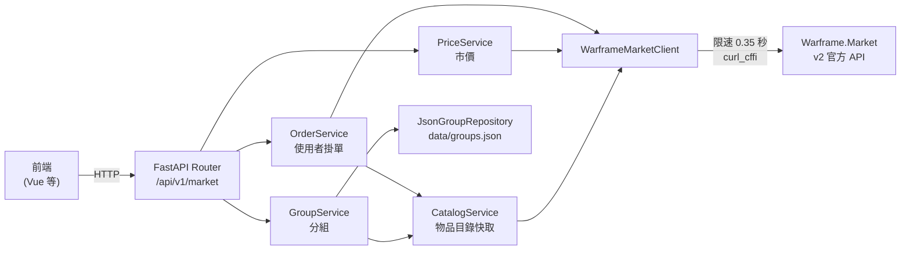

# 系統說明文件

Warframe.Market 賣場小幫手的後端。以 [Warframe.Market v2 官方 API](https://api.warframe.market/v2) 為核心，提供物品目錄、使用者掛單、市價與物品分組等 API，供多個前端共用。

> 文件與程式碼放在同一個 repo。修改程式時，若影響到這裡描述的行為，請在同一個 PR 一併更新文件。

## 文件索引

| 文件 | 內容 | 適合什麼時候看 |
|---|---|---|
| [architecture.md](architecture.md) | 六角架構分層、各模組職責、組裝與依賴注入、錯誤處理、設定 | 第一次接觸這個專案、要新增功能時 |
| [data-flow.md](data-flow.md) | 啟動、物品目錄更新、掛單查詢、市價查詢、分組查詢的流程圖 | 想知道某個請求實際經過哪些步驟 |
| [api.md](api.md) | 每支 API 的參數、回應範例與錯誤碼 | 串接前端、除錯 API 回應 |
| [official-api.md](official-api.md) | WFM v2 官方 API 的實測紀錄與限制 | 要串接新的官方端點、官方回應怪怪的 |
| [groups.md](groups.md) | 物品分組的資料格式、來源與維護方式 | 要新增或修改分組 |
| [testing.md](testing.md) | 測試架構、fixtures、測試工具 | 要寫測試、測試失敗 |
| [decisions.md](decisions.md) | 設計決策紀錄：做了什麼選擇、為什麼 | 想改某個設計之前，先看當初的理由 |

## 一張圖看懂整個系統

## 快速對照

| 想做的事 | 看哪裡 |
|---|---|
| 啟動後端、執行測試 | 專案根目錄的 [README](../README.md) |
| 查看所有 API 並直接試打 | 啟動後開啟 http://127.0.0.1:8000/docs |
| 調整快取時間、請求間隔 | `app/config.py`，說明見 [architecture.md#設定](architecture.md#設定) |
| 新增一支 API | [architecture.md#新增功能的步驟](architecture.md#新增功能的步驟) |
| 補 Baro Ki'Teer 的物品 | [groups.md#手動維護](groups.md#手動維護) |
