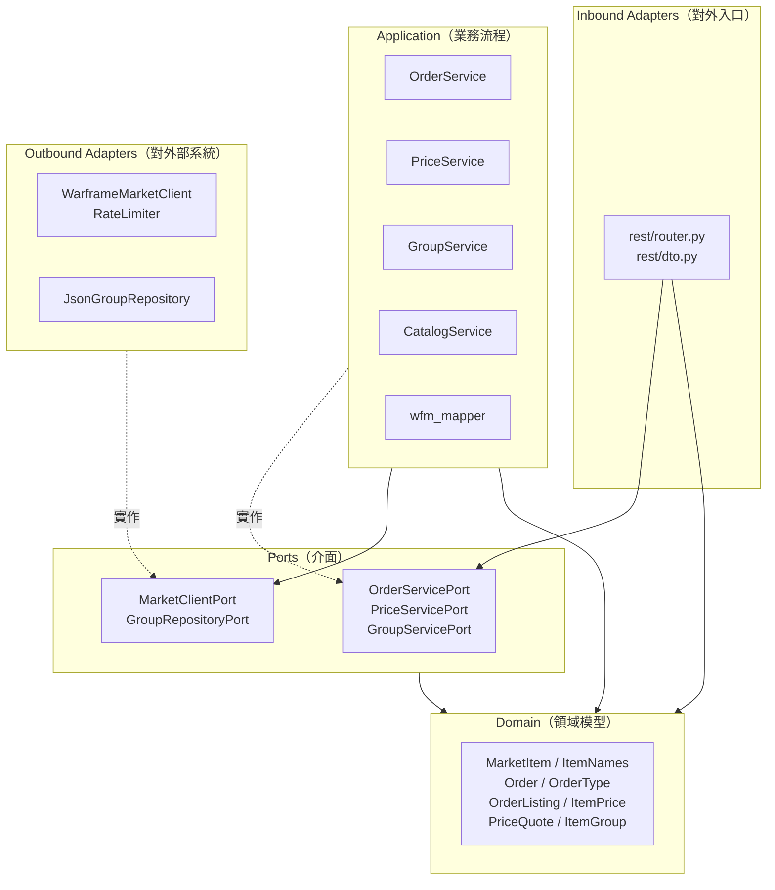
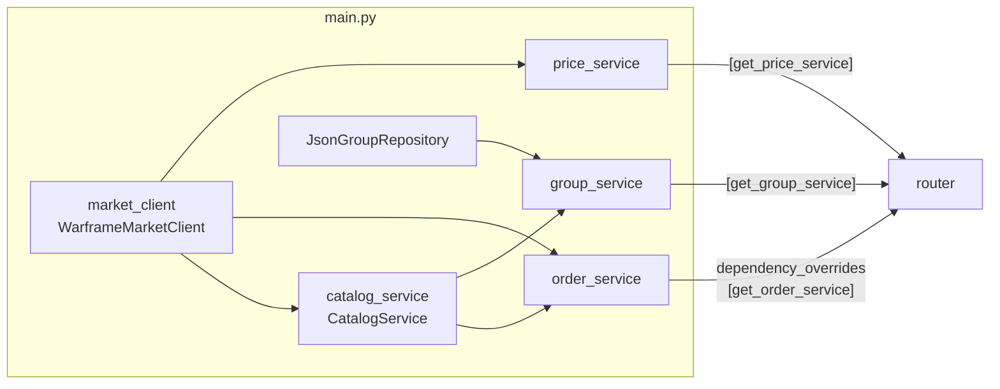

# 系統架構

## 六角架構分層

專案採用六角架構（Hexagonal Architecture，又稱 Ports and Adapters）。核心規則只有一條：**相依方向只能往內**。外層可以依賴內層，內層不知道外層的存在。



| 層 | 目錄 | 職責 | 可以依賴 |
|---|---|---|---|
| Domain | `app/domain/` | 純資料結構與業務規則（例如價格至少 1 白金） | 無 |
| Ports | `app/ports/` | 抽象介面（ABC），定義「需要什麼能力」 | Domain |
| Application | `app/application/` | 業務流程：快取、合併、篩選、補資料 | Domain、Ports |
| Inbound Adapter | `app/adapters/inbound/rest/` | HTTP 路由、Pydantic DTO、例外轉 HTTP 狀態碼 | Domain、Ports |
| Outbound Adapter | `app/adapters/outbound/` | 實際呼叫官方 API、讀取 JSON 檔 | Domain、Ports |
| Composition Root | `main.py` | 建立所有實體並組裝在一起 | 全部 |

> Application 層的服務彼此可以直接依賴（例如 `OrderService` 依賴 `CatalogService`），因為它們在同一層。

## 各模組職責

### Domain

| 類別 | 檔案 | 說明 |
|---|---|---|
| `ItemNames` | `market_item.py` | 三語名稱 `en` / `zh_hant` / `zh_hans`。`get(language)` 缺少該語言時退回英文 |
| `MarketItem` | `market_item.py` | 官方物品目錄中的一筆物品。`image` 屬性優先用縮圖，沒有時用原圖 |
| `Order`、`OrderType` | `order.py` | 一筆掛單。`update_price` / `update_quantity` 會檢查至少為 1 |
| `OrderListing` | `order_listing.py` | 掛單 + 對應的物品資訊；物品目錄查不到時 `item` 為 `None` |
| `ItemPrice`、`PriceQuote` | `item_price.py` | 市價：最低賣價、最高收購價，每筆報價帶有自己的 rank |
| `ItemGroup` | `item_group.py` | 本專案維護的物品分組（官方沒有分組資料） |

以上全部是 `dataclass`，其中 `MarketItem`、`ItemNames`、`OrderListing`、`ItemPrice`、`PriceQuote`、`ItemGroup` 是 `frozen`（不可變）。

### Ports

| 介面 | 方向 | 實作 |
|---|---|---|
| `OrderServicePort` | Inbound | `OrderService` |
| `PriceServicePort` | Inbound | `PriceService` |
| `GroupServicePort` | Inbound | `GroupService` |
| `MarketClientPort` | Outbound | `WarframeMarketClient` |
| `GroupRepositoryPort` | Outbound | `JsonGroupRepository` |

`MarketClientPort` 的約定（寫在 docstring 中）：
- 只負責取得資料，回傳官方回應中 `data` 欄位的**原始內容**，不做任何業務過濾
- 找不到資源丟 `KeyError`，其他通訊失敗丟 `RuntimeError`

### Application

| 模組 | 說明 |
|---|---|
| `wfm_mapper.py` | 把官方的原始 dict 轉成 domain 模型：camelCase 轉 snake_case、圖片相對路徑補成完整網址。`to_orders()` 轉換多筆掛單時會略過格式錯誤的那筆 |
| `catalog_service.py` | 物品目錄的記憶體快取，以 itemId 為 key。詳見 [data-flow.md#物品目錄更新](data-flow.md#物品目錄更新) |
| `order_service.py` | 查詢使用者掛單，並用物品目錄補上物品資訊 |
| `price_service.py` | 查詢市價並快取 |
| `group_service.py` | 列出分組、取得分組內的物品、檢查分組中不存在的 slug |

### Adapters

| 模組 | 說明 |
|---|---|
| `rest/router.py` | 所有路由，前綴 `/api/v1/market`。負責例外轉 HTTP 狀態碼 |
| `rest/dto.py` | 對外的回應格式。回應統一包成 `APIResponse{code, message, data}`；DTO 用 `from_domain()` 從 domain 模型轉換 |
| `outbound/wf_market_client.py` | 呼叫官方 API。用 `curl_cffi` 模擬 Chrome 的 TLS 指紋以通過 Cloudflare |
| `outbound/rate_limiter.py` | 限制連續請求的最短間隔 |
| `outbound/json_group_repository.py` | 讀取 `data/groups.json` |

## 組裝與依賴注入

`main.py` 是唯一知道「具體用哪個實作」的地方：



- 只有**一個** `WarframeMarketClient`，所有服務共用，所以也共用同一個限速器
- 只有**一個** `CatalogService`，`OrderService` 與 `GroupService` 共用同一份物品目錄
- `router.py` 裡的 `get_order_service()` 等函式只是佔位，會丟 `NotImplementedError`；`main.py` 透過 `app.dependency_overrides` 換成實際的服務
- 路由參數使用 `Annotated` 別名（`OrderServiceDep` 等），避免 ruff 的 B008 規則（參數預設值不能呼叫函式）

### 生命週期（lifespan）

```python
await catalog_service.warm_up()        # 預熱物品目錄，失敗只記錄錯誤
group_service.find_unknown_slugs()     # 檢查分組 slug，有問題只記錄警告
catalog_service.start_periodic_refresh()
yield                                  # 開始接受請求
await catalog_service.stop_periodic_refresh()
```

流程圖見 [data-flow.md#啟動流程](data-flow.md#啟動流程)。

## 錯誤處理

例外在 router 統一轉成 HTTP 狀態碼：

| 例外 | 狀態碼 | 典型情境 |
|---|---|---|
| `KeyError` | 404 | 官方找不到使用者或物品、找不到分組 |
| `ValueError` | 400 | 沒有指定使用者名稱（`/me/orders` 且 config 沒有預設值） |
| `RuntimeError`、`OSError` | 502 | 官方 API 非 200、連線失敗、回應不是 JSON |
| 其他 `Exception` | 500 | 掛單 API 會攔截並回「系統內部未知錯誤」；其他 API 由 FastAPI 預設處理 |
| 參數驗證失敗 | 422 | FastAPI 自動處理，例如 `type=x`、`rank=-1` |

`KeyError` 的訊息會先去掉引號（`str(e).strip("'\"")`），因為 `str(KeyError("x"))` 會變成 `'x'`。

## 設定

設定集中在 `app/config.py` 的 frozen dataclass，沒有 `.env`。

| 設定 | 預設值 | 說明 |
|---|---|---|
| `API_PORT` | `8000` | `python main.py` 的埠號 |
| `ALLOWED_ORIGINS` | `localhost:5173`、`127.0.0.1:5173` | CORS 允許的前端來源 |
| `WF_MARKET_API_URL` | `https://api.warframe.market/v2` | 官方 API |
| `WF_MARKET_ASSETS_URL` | `https://warframe.market/static/assets/` | 官方圖片前綴 |
| `WF_MARKET_MIN_REQUEST_INTERVAL` | `0.35` 秒 | 連續請求官方的最短間隔（官方限制約每秒 3 次） |
| `CATALOG_REFRESH_INTERVAL` | `3600` 秒 | 定期檢查物品目錄版本的間隔 |
| `CATALOG_MISS_REFRESH_COOLDOWN` | `300` 秒 | 查不到物品時觸發更新的冷卻時間 |
| `PRICE_CACHE_TTL` | `300` 秒 | 市價快取時間 |
| `GROUPS_FILE` | `data/groups.json` | 分組資料檔（絕對路徑） |
| `DEFAULT_WF_USERNAME` | `""` | `/me/orders` 沒帶 `username` 時使用 |

## 新增功能的步驟

以「新增一支 API」為例，由內往外：

1. **Domain**：需要新的資料結構就在 `app/domain/` 新增 dataclass
2. **Outbound Port**：需要新的官方端點，在 `MarketClientPort` 加抽象方法，並在 `WarframeMarketClient` 實作（透過 `_get()`，自動套用限速與錯誤轉換），同時更新 `tests/support.py` 的 `FakeMarketClient`
3. **Mapper**：官方原始資料轉 domain 的邏輯放在 `wfm_mapper.py`
4. **Inbound Port + Service**：在 `app/ports/` 定義介面、在 `app/application/` 實作
5. **DTO + Router**：在 `dto.py` 加回應格式（附 `from_domain()`），在 `router.py` 加佔位函式、`Annotated` 別名與路由
6. **main.py**：建立服務並加上 `dependency_overrides`
7. **測試**：單元測試 + API 測試，並更新 `tests/api/test_routes.py` 的路由清單
8. **文件**：更新 `docs/api.md`、`api.http`，有設計取捨就記到 `docs/decisions.md`
