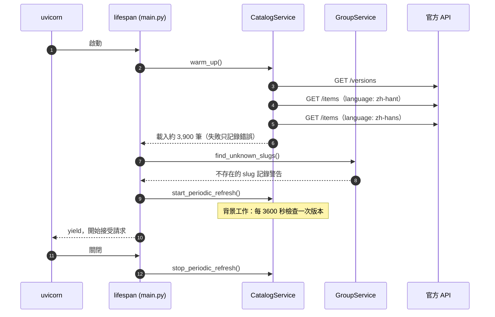
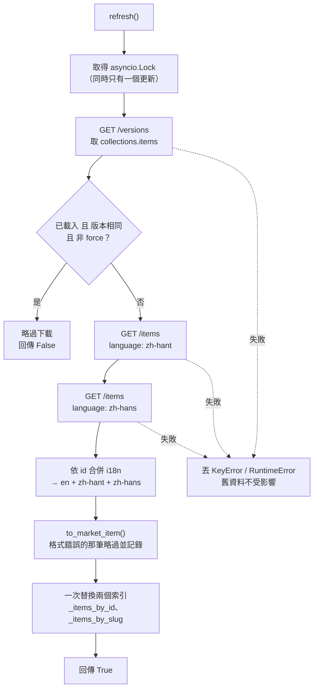
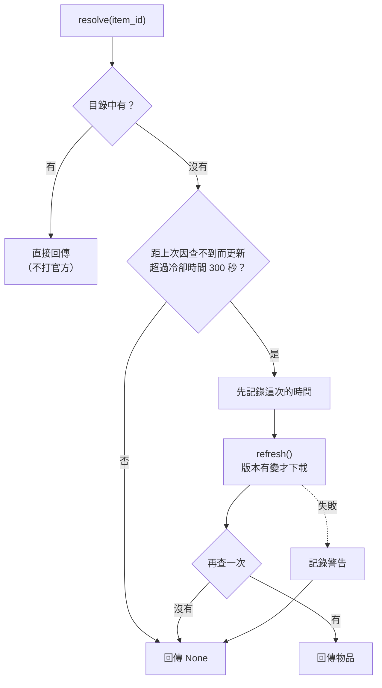
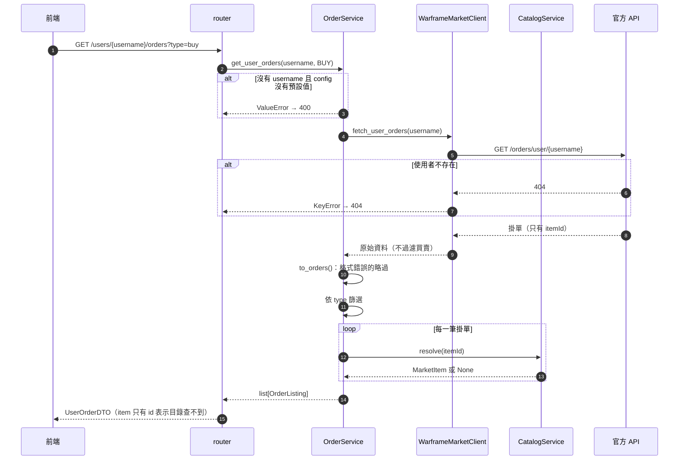
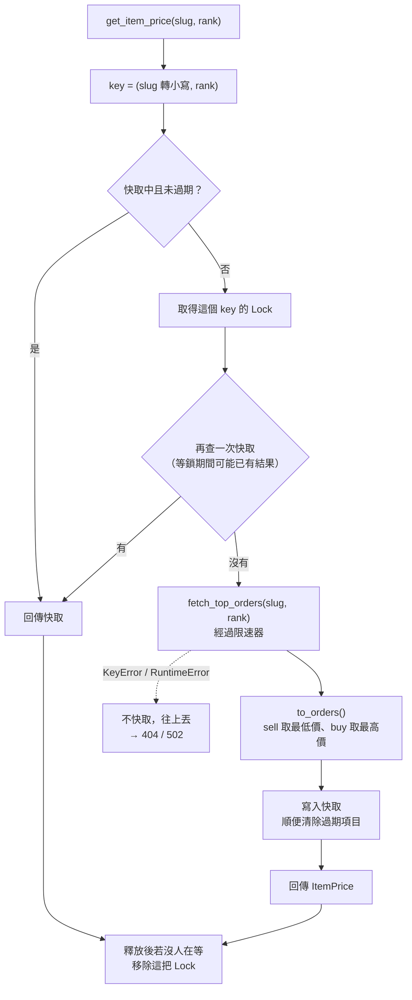
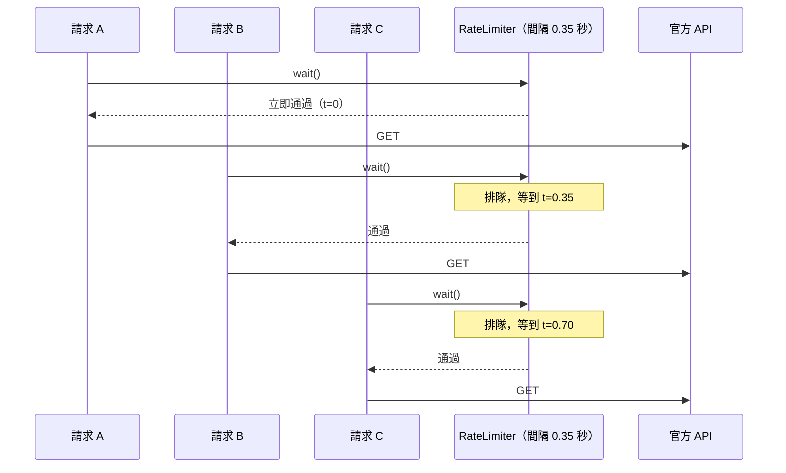
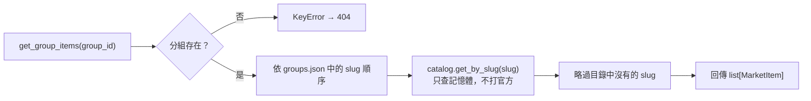

# 資料流程

## 啟動流程

- 預熱需要 3 個請求（含限速）約 3～4 秒。預熱完成**之後**才開始接受請求，所以第一個請求就查得到物品
- 官方很慢時，最久要等到逾時（每個請求 15 秒）
- 預熱失敗（官方掛掉、網路不通）不會讓後端啟動失敗：物品目錄是空的，等下一次定期檢查或第一次「查不到物品」時再重試

## 物品目錄更新

`CatalogService.refresh(force=False)`，以 `asyncio.Lock` 確保同一時間只有一個更新在執行。

**為什麼要下載兩次：** 官方 `/items` 的 `i18n` 只會回傳 `en` 加上 `language` header 指定的那一種語言，所以繁中、簡中要各抓一次再合併。

**觸發時機：**

| 觸發 | 方式 | 失敗時 |
|---|---|---|
| 啟動 | `warm_up()` → `refresh(force=True)` | 記錄錯誤，後端照常啟動 |
| 定期 | 背景工作每 `CATALOG_REFRESH_INTERVAL` 秒呼叫 `refresh()` | 記錄錯誤，下一輪繼續 |
| 查不到物品 | `resolve(item_id)`，見下一節 | 記錄警告，回傳 `None` |

## 用 itemId 查物品（resolve）

官方的使用者掛單只有 `itemId`，新物品上架時本地目錄可能還沒有，所以查不到時會嘗試更新一次。

**先記錄時間再更新**，是為了讓同時進來的多個「查不到」請求只觸發一次更新：第一個請求記下時間後，其餘請求在冷卻檢查時就會直接回傳 `None`。

## 查詢使用者掛單

`GET /api/v1/market/users/{username}/orders?type=buy`（`/me/orders` 走同一段處理）

## 查詢市價

`GET /api/v1/market/items/{slug}/price?rank=10`

- 快取以 `(slug, rank)` 為單位：`rank=None`、`rank=0`、`rank=10` 是三筆不同的快取
- **同一個 key 同時有多個請求**時，只有第一個會打官方，其餘等鎖後直接拿到快取結果
- 不同物品之間不互相等待，但都會經過同一個限速器排隊
- 錯誤不快取，下一次查詢會重新打官方

## 請求限速

所有連到官方的請求都經過 `WarframeMarketClient._get()`，第一步就是 `await RateLimiter.wait()`。

限速器只限制「發出請求的時間間隔」，不會等前一個請求回應完成，所以官方回應慢時不會拖累後面的請求排隊。

## 查詢分組物品

`GET /api/v1/market/groups/{group_id}/items`

分組查詢**完全不會打官方**，所以很快；但若啟動時預熱失敗、目錄是空的，分組會回傳空陣列，直到目錄載入成功。
