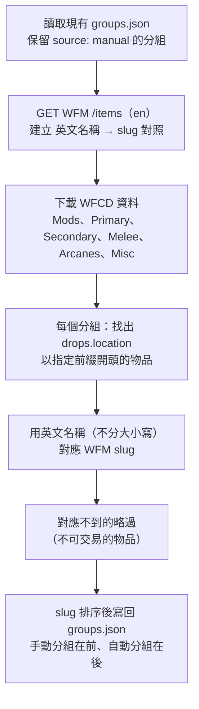

# 物品分組

官方 API 沒有「哪個商人或集團賣哪些物品」的資料，所以由本專案維護在 `data/groups.json`。前端透過 `/groups` 與 `/groups/{group_id}/items` 取得（見 [api.md](api.md#物品分組)）。

## 資料格式

```json
{
  "groups": [
    {
      "id": "baro_ki_teer",
      "names": { "en": "Baro Ki'Teer", "zh_hant": "Baro Ki'Teer", "zh_hans": "Baro Ki'Teer" },
      "source": "manual",
      "slugs": ["primed_continuity", "primed_target_cracker"]
    }
  ]
}
```

| 欄位 | 必填 | 說明 |
|---|---|---|
| `id` | ✅ | 分組 id，用在 API 路徑；不可重複 |
| `names.en` | ✅ | 英文名稱 |
| `names.zh_hant`、`names.zh_hans` | | 繁中、簡中名稱 |
| `source` | | `manual`（手動維護）或 `wfcd`（腳本產生）；只有產生腳本會讀這個欄位 |
| `slugs` | | WFM 物品 slug 清單，順序就是 API 回傳的順序 |

`JsonGroupRepository` 在後端啟動時讀取，規則：
- 缺少 `id`、`names` 或 `names.en` → `ValueError`，**後端無法啟動**
- `id` 重複 → `ValueError`，**後端無法啟動**
- 同一分組中重複的 slug 會自動去除，保留第一次出現的位置

## 目前的分組

| id | 名稱 | 來源 | 物品數 |
|---|---|---|---|
| `baro_ki_teer` | Baro Ki'Teer | manual | 2 |
| `steel_meridian` | 鋼鐵防線 | wfcd | 81 |
| `arbiters_of_hexis` | 均衡仲裁者 | wfcd | 76 |
| `cephalon_suda` | 中樞蘇達 | wfcd | 73 |
| `the_perrin_sequence` | 佩蘭數列 | wfcd | 74 |
| `red_veil` | 血色面紗 | wfcd | 80 |
| `new_loka` | 新世間 | wfcd | 77 |
| `steel_path_acolytes` | 鋼鐵之路追隨者 | wfcd | 6 |

集團分組包含該集團聲望可兌換、且能在 WFM 交易的物品：增幅 Mod、集團武器（勇氣、終極、樞議、保障、緋紅、聖潔系列）、場景等。增幅 Mod 通常由兩個友好集團共同販售，所以同一個物品可能出現在多個分組。

## 手動維護

`source: manual` 的分組直接編輯 `data/groups.json`：

1. 到 [warframe.market](https://warframe.market) 找到物品，網址最後一段就是 slug（例如 `https://warframe.market/items/primed_flow` → `primed_flow`）
2. 加到對應分組的 `slugs`
3. 重新啟動後端，確認 log 沒有「分組 … 有 … 個 slug 不在物品目錄中」的警告
4. 執行 `pytest`（`test_project_groups_file_is_valid` 會檢查檔案格式）

新增分組時，`id` 用小寫英文加底線，並補齊三語名稱。

## 自動產生（WFCD）

`source: wfcd` 的分組由腳本產生：

```powershell
python scripts/build_groups.py
```



各分組對應的 WFCD `drops.location` 前綴：

| 分組 | location 前綴 |
|---|---|
| 鋼鐵防線 | `Steel Meridian,` |
| 均衡仲裁者 | `Arbiters of Hexis,` |
| 中樞蘇達 | `Cephalon Suda,` |
| 佩蘭數列 | `The Perrin Sequence,` |
| 血色面紗 | `Red Veil,` |
| 新世間 | `New Loka,` |
| 鋼鐵之路追隨者 | `Angst (`、`Malice (`、`Mania (`、`Misery (`、`Torment (`、`Violence (` |

WFCD 的集團資料格式為「集團, 聲望階級」，例如 `Steel Meridian, General`；追隨者為「名稱 (Level 0 - 100)」。

### 注意事項

- **WFCD 固定在 `1.1276.3` 版**（`WFCD_VERSION`）。`1.1276.19` 起部分物品缺少 `drops` 欄位，用新版產生時每個集團都會是 0 筆。要升級版本時，先確認產生出來的筆數合理
- 腳本會連線 jsDelivr 與 WFM 官方 API
- 要新增自動分組，在 `GENERATED_GROUPS` 加一筆 `id`、`names`、`locations`
- 集團中文名稱取自 WFCD 繁中、簡中翻譯中的**集團浮印**名稱（例如「鋼鐵防線浮印」），也就是遊戲內的官方譯名

## 啟動時的檢查

後端啟動、物品目錄預熱完成後，`GroupService.find_unknown_slugs()` 會檢查每個 slug 是否存在於官方目錄：

```
WARNING app.application.group_service: 分組 baro_ki_teer 有 1 個 slug 不在物品目錄中: primed_flwo
```

- 只記錄警告，不影響啟動；API 回傳時會略過這些 slug
- 物品目錄沒有載入成功時會略過檢查

常見原因：slug 打錯、官方更改了 slug、物品從 WFM 下架。

## 待確認

- [ ] Baro Ki'Teer 目前只有 2 筆（沿用早期 mock 資料），商品會輪替且沒有可靠資料來源，需手動補齊
- [ ] 「鋼鐵之路追隨者」的譯名未經驗證（WFCD 沒有 Acolyte 的中文翻譯）
